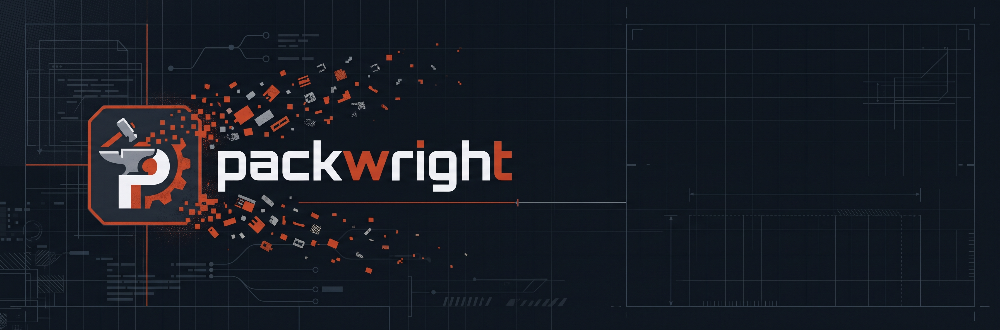
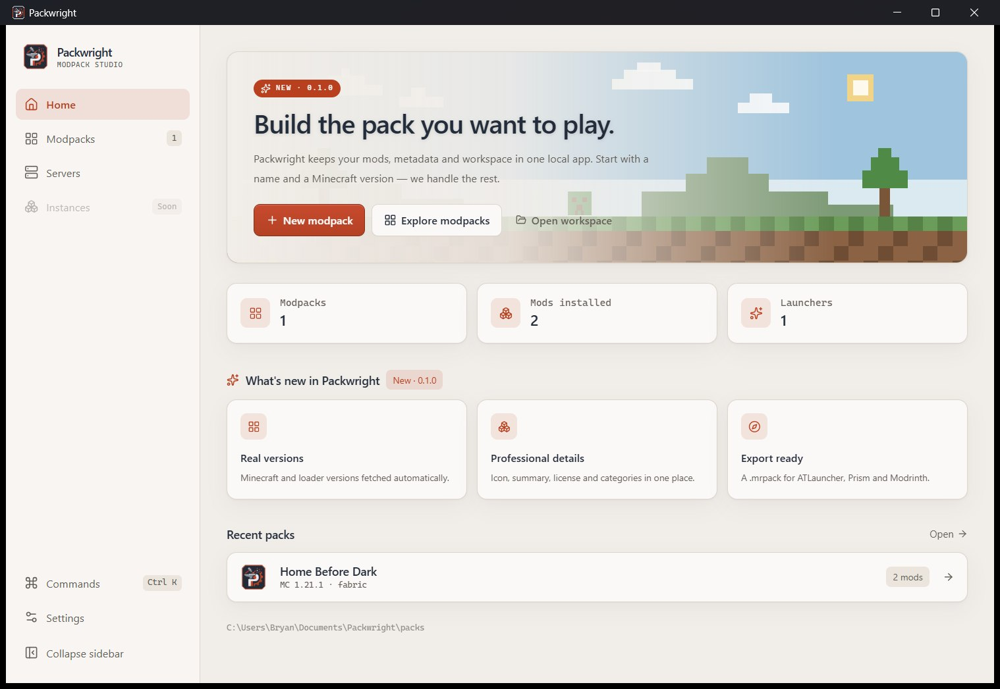
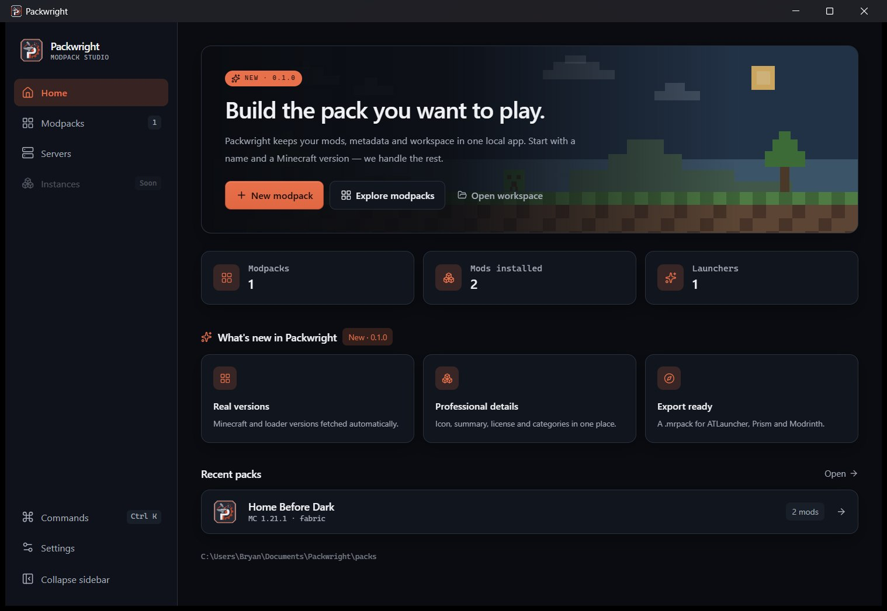
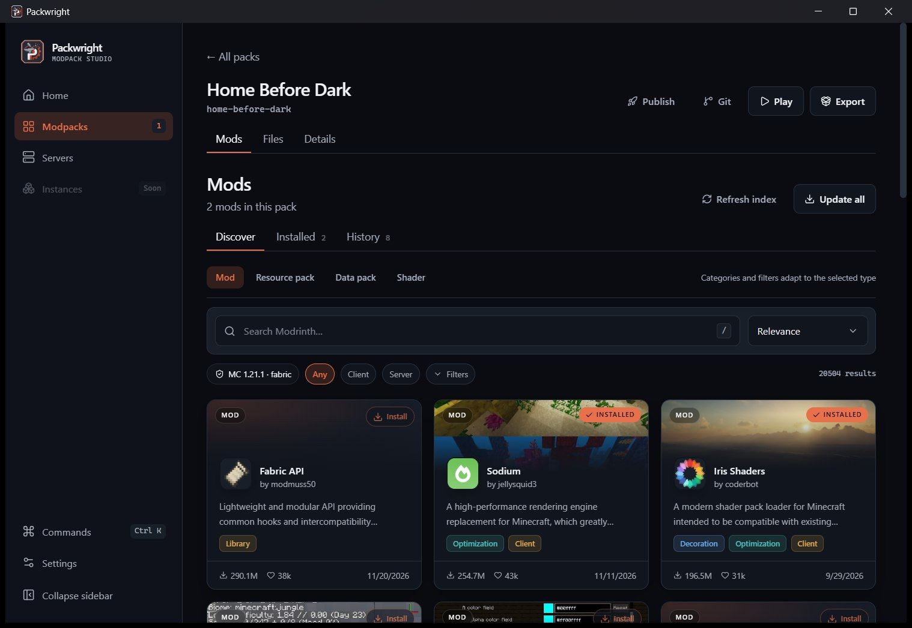
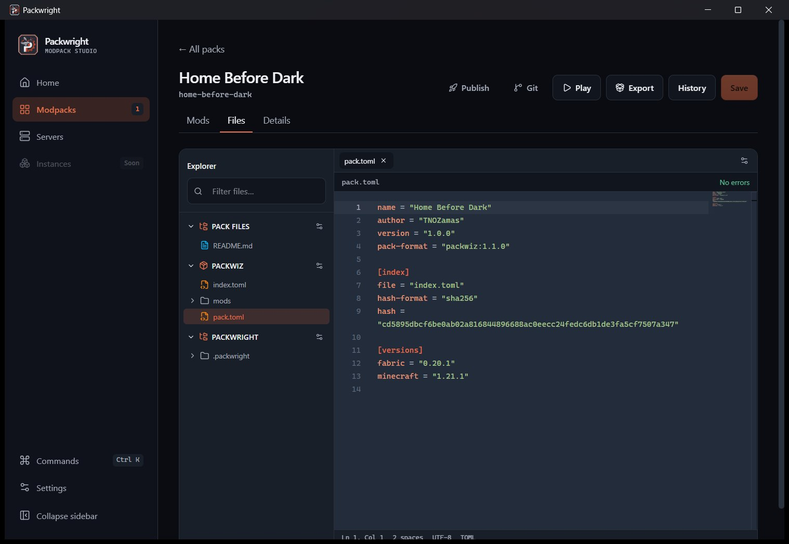
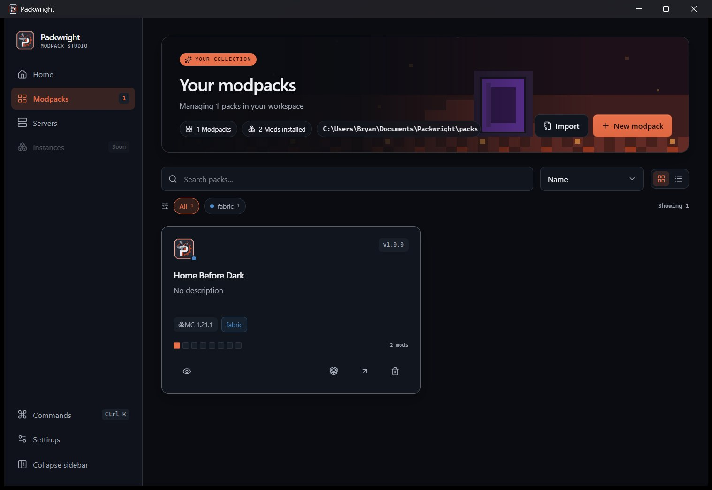
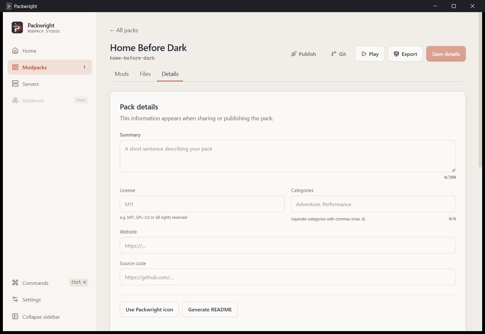
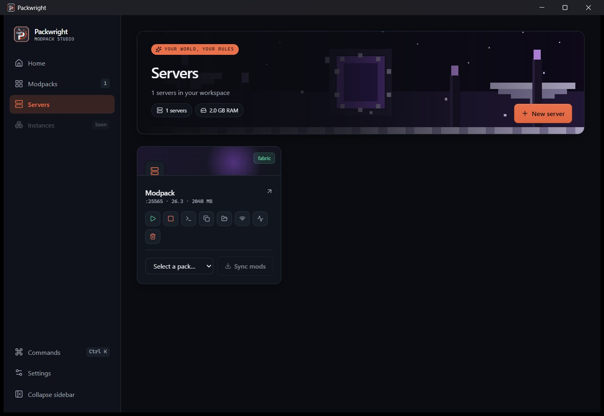
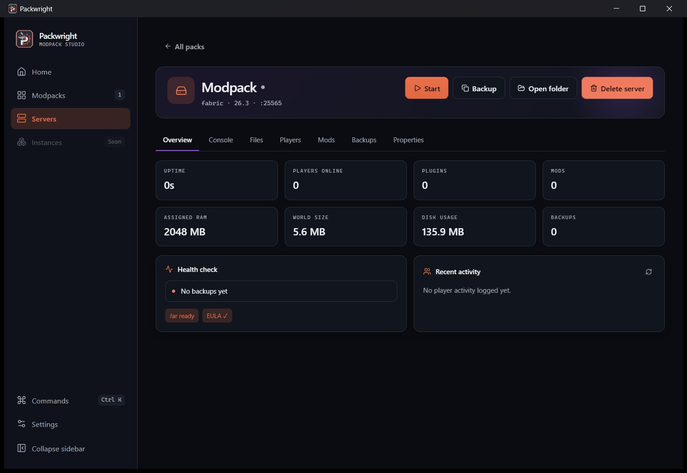

# Packwright

> **Build modpacks. Launch servers. One desktop app.**
> El estudio local donde tu modpack y tu servidor dejan de ser dos proyectos distintos.

[](https://github.com/bgrados31/packwright/actions/workflows/ci.yml)
[](https://github.com/bgrados31/packwright/actions/workflows/release.yml)
[](https://github.com/bgrados31/packwright/releases/latest)


---

## El problema

Crear un modpack de Minecraft hoy significa saltar entre herramientas: editar TOML a mano, buscar mods en webs distintas, copiar jars, configurar un servidor por separado y repetir el proceso cada vez que sale una versión nueva.

## La idea

**Packwright reúne las dos mitades en una sola app de escritorio.** Un único workspace local, una sola biblioteca de mods, una sola fuente de verdad:

```
                    Workspace Packwright
              (un caché de mods compartido)
                            │
             ┌──────────────┴──────────────┐
             ▼                             ▼
       Modpack (packwiz)              Servidor (Paper, Forge…)
       pack.toml + mods/*.pw.toml  ◀─sync─▶  jar + mundo + plugins
             │                             │
             ▼                             ▼
     ATLauncher / Prism / Modrinth     start/stop + consola + backups
```

Todo ocurre en tu equipo. Sin cuentas, sin servidores de terceros, sin suscripciones.

---

## Lo que puedes hacer

### Modpacks, de principio a fin
- Crear packs `packwiz` con versiones reales de Minecraft y loader (Fabric, Forge, NeoForge, Quilt, Purpur).
- **Catálogo de Modrinth** con búsqueda, filtros, categorías, entorno y detalle de versiones.
- Instalar, actualizar, fijar (pin) y quitar mods en un clic, con dependencias resueltas.
- Metadatos profesionales: resumen, licencia, categorías, icono, banner, galería y README generado.
- Health checks (duplicados, sin fuente, conflictos), historial por pack y exportación `.mrpack` / `.zip`.
- Importar desde Modrinth o CurseForge, y publicar directamente en Modrinth.

### Editor y flujo de desarrollo
- Editor **Monaco** local con TOML/JSON/YAML/MD/XML, validación en vivo, guardado atómico e historial con restore.
- Árbol multi-root (Pack / Packwiz / Packwright), pestañas reordenables, renombrado y menús contextuales.
- **Play** en un paso: `packwiz serve` + instancia de prueba (symlink) + watcher + launcher. Detecta automáticamente Prism, Modrinth App, MultiMC y ATLauncher instalados; puedes marcar el preferido en Ajustes y la instancia se crea en su carpeta de instancias cuando el formato es compatible.
- Consola flotante, command palette (`Ctrl/Cmd+K`) e i18n español/inglés.

### Servidores propios
- Templates Vanilla, Paper, Purpur, Forge, NeoForge, Fabric y Velocity con setup automático.
- Start/stop/restart con **consola interactiva**, autocompletado e historial de comandos.
- Ping real del protocolo MC (jugadores, MOTD, latencia), backups, restore y gestión de ops/whitelist/bans.
- Sincronización cliente ↔ servidor y túnel opcional **playit.gg**.

### Cuidado y seguridad
- Temas **claro y obsidiana** con contraste AA, focus visible y `prefers-reduced-motion`.
- Eliminación completa de packs y servidores con **confirmación escribiendo el nombre**.
- Secretos redactados en la interfaz, CSP estricto y rutas validadas en el backend.

---

## Galería

| Inicio — claro | Inicio — obsidiana |
| --- | --- |
|  |  |

| Catálogo de mods | Editor de archivos |
| --- | --- |
|  |  |

| Mis modpacks | Detalles del pack |
| --- | --- |
|  |  |

| Servidores | Panel del servidor |
| --- | --- |
|  |  |

> Todas las capturas son de la app real ejecutándose, no maquetas.

---

## Para quién es

| Perfil | Qué gana |
| --- | --- |
| **Creador de modpacks** | Deja de pelear con TOML y manages el catálogo desde una UI. |
| **Dueño de servidor** | Configura, arranca y respalda su servidor sin terminal. |
| **Grupo de amigos** | El mismo pack para todos y un servidor sincronizado en minutos. |
| **Modder / autor** | Prepara releases con README, icono y exportación listos para publicar. |

---

## Descargas

Cada push a `main` publica automáticamente una nueva release con:
**instalador de Windows (`.exe` NSIS)**, **paquetes de Linux (`.deb` / `.AppImage`)** y **`.dmg` universal de macOS**, junto con un changelog generado desde los commits del release anterior.

👉 [Descargar la última versión](https://github.com/bgrados31/packwright/releases/latest) · [Ver el historial de cambios](CHANGELOG.md)

Las versiones instaladas comprueban actualizaciones al abrir **Ajustes → Actualizaciones** y permiten descargar e instalar sin volver a GitHub. Cada release publica un `latest.json` firmado con la clave del updater.

> Las releases se publican desde `.github/workflows/release.yml`. El changelog se calcula con `git log` entre tags y se adjunta a cada release.

## Instalación y desarrollo

```bash
bun install
bun run tauri dev        # app de escritorio con hot reload
```

Solo el frontend:

```bash
bun run dev              # Vite en http://localhost:1420
```

Build de producción (instaladores `.msi` / `.deb` / `.dmg`):

```bash
bun run tauri build
```

Tests:

```bash
bun run build            # typecheck + build del frontend
cd src-tauri && cargo test
```

**Requisitos:** [Bun](https://bun.sh/) ≥ 1.4, [Rust](https://rustup.rs/) estable, MSVC Build Tools en Windows y [packwiz](https://packwiz.infra.link/installation/) en el PATH.

---

## Arquitectura

| Capa | Tecnología |
| --- | --- |
| Nativo | **Rust** (Tauri 2): filesystem, TOML, packwiz, procesos, descargas, backups |
| UI | **React 19 + TypeScript** con Tailwind 4 y Monaco |
| Build | Vite 8 |

Ver el plan detallado en [ROADMAP.md](ROADMAP.md) y el kit de marca en [docs/ASSETS-PROMPT.md](docs/ASSETS-PROMPT.md) y [docs/SHOWCASE.md](docs/SHOWCASE.md).

## Estado

🚧 **MVP funcional en beta.** La interfaz y los flujos principales están listos; no lanzar aún en producción.

## Licencia

Pendiente de definir.
